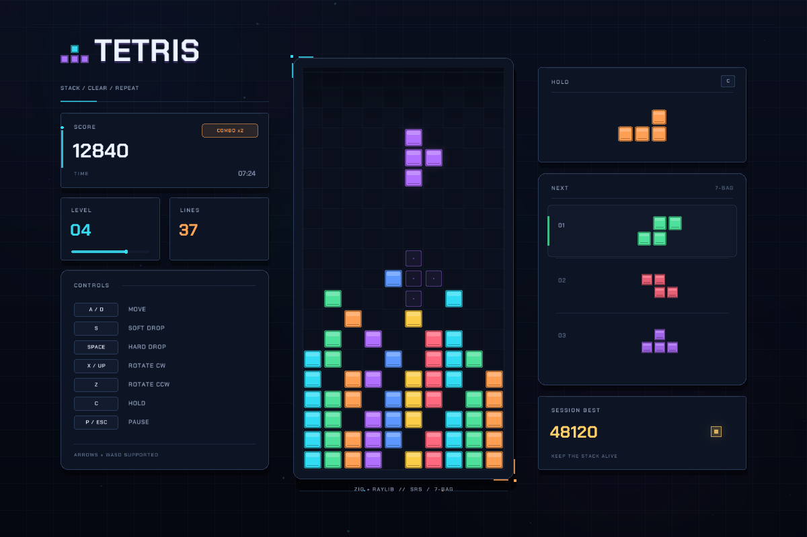

# TETRIS · Zig + Raylib

一个霓虹科幻风格的俄罗斯方块，完全用 **Zig** 和 **Raylib** 实现。没有外部图片或音频文件：字体嵌入可执行文件，音效由代码实时合成。



## 特性

- **现代规则**：SRS 旋转系统与完整墙踢表、7-bag 随机器、Hold、3 个 Next 预览、Ghost 落点。
- **顺滑操作**：DAS/ARR 平滑横移、软降、硬降、旋转、暂停、重开。
- **完整计分**：消行、连击、等级加速、本次运行最高分。
- **有手感的画面**：发光方块、消行闪白、粒子碎块、屏幕震动、得分/等级脉冲、响应式缩放。
- **纯程序化音效**：移动、旋转、锁定、硬降、Hold、消行、Tetris、升级、Game Over。
- **无运行时素材依赖**：Chakra Petch 字体随二进制嵌入；Raylib 静态链接。

## 构建与运行

需要 **Zig 0.17.1**。首次构建会通过 `build.zig.zon` 获取 Raylib 依赖，因此需要网络。

```bash
zig build run
```

构建发布版：

```bash
zig build -Doptimize=ReleaseFast
./zig-out/bin/tetris
```

运行逻辑测试：

```bash
zig build test
```

## 操作

| 按键 | 功能 |
| --- | --- |
| `A` / `D` 或 `←` / `→` | 左右移动（带 DAS/ARR 连发） |
| `S` 或 `↓` | 软降（每格 +1 分） |
| `Space` | 硬降（每格 +2 分，立即锁定） |
| `X` / `↑` / `W` | 顺时针旋转 |
| `Z` / `Left Ctrl` | 逆时针旋转 |
| `C` / `Shift` | Hold（每个方块限一次） |
| `P` / `Esc` | 暂停 / 继续 |
| `R` | 重新开始 |
| `Enter` | Game Over 后重新开始 |
| `M` | 静音切换 |
| `F11` | 全屏切换 |

## 计分

| 消行 | 基础分 |
| --- | ---: |
| 1 行 | 100 |
| 2 行 | 300 |
| 3 行 | 500 |
| 4 行 | 800 |

- 基础分乘以当前等级。
- 连续消行额外获得 `50 × 连击数 × 等级` 分。
- 每消 10 行升 1 级，下落速度逐渐加快（有最低间隔限制）。
- 软降每格 +1 分；硬降每格 +2 分。

## 项目结构

```text
build.zig                  Zig 构建脚本（Raylib 静态链接、run/test 步骤）
build.zig.zon              依赖与包信息
src/main.zig               程序入口：参数、资源生命周期、主循环
src/app.zig                应用状态：串联规则、输入、音效和渲染
src/cli.zig                命令行选项与截图场景
src/demo.zig               演示局面和截图场景初始化
src/capture.zig            离屏截图与 PNG 导出
src/root.zig               对外导出的包 API、测试汇总入口

src/game/                  纯规则层，不依赖 Raylib
  piece.zig                方块定义、SRS 旋转表、踢墙偏移
  board.zig                网格碰撞、锁定、满行检测与消行塌落
  bag.zig                  7-bag 随机器
  scoring.zig              消行/连击/等级计分
  events.zig               规则层事件与事件队列
  game.zig                 游戏状态机、重力、锁定、暂停、升级
  showcase.zig             演示用局面

src/ui/                    表现层，依赖 Raylib
  theme.zig                调色板、布局尺寸、方块配色
  fonts.zig                内嵌字体加载
  draw.zig                 文本、几何与方块绘制
  widgets.zig              面板、卡片标题、预览等复用组件
  background.zig           渐变、网格、光晕与星尘背景
  hud_left.zig             分数、等级、行数、操作说明
  hud_right.zig            Hold、Next、Session Best
  playfield.zig            棋盘、幽灵块、活动方块、消行闪光
  overlays.zig             暂停与 Game Over 覆盖层
  effects.zig              粒子、横幅、震动与脉冲
  audio.zig                程序化音效与音频设备管理
  input.zig                游戏按键、DAS/ARR 和软降
  state.zig                只读渲染快照
  screen.zig               虚拟画布、摄像机与整帧合成
  window.zig               窗口创建、图标与平台初始化

src/assets/fonts/          嵌入的 Chakra Petch 字体与 OFL 许可证
screenshot.png             游戏截图
```

模块依赖保持单向：`main → app → game/ui`。游戏规则层不知道窗口、键盘或
Raylib 的存在，因此可以在无显示环境下完整测试。

## 截图模式（开发辅助）

程序支持离屏、固定 1200×800 的截图渲染，方便生成一致的预览图：

```bash
# 预设中局
./zig-out/bin/tetris --demo --screenshot screenshot.png --scene play

# 暂停 / 消行 / 结束画面
./zig-out/bin/tetris --screenshot paused.png --scene paused
./zig-out/bin/tetris --screenshot clear.png --scene clear
./zig-out/bin/tetris --screenshot over.png --scene game_over

# 固定随机种子
./zig-out/bin/tetris --demo --seed 42 --screenshot demo.png
```

## 字体许可

Chakra Petch 字体来自 [The Chakra Petch Project](https://github.com/m4rc1e/Chakra-Petch)，采用 **SIL Open Font License 1.1**。完整许可证见 [`src/assets/fonts/OFL.txt`](src/assets/fonts/OFL.txt)。

Raylib 由 [raysan5](https://www.raylib.com/) 开发，采用 zlib 许可证；通过 [raylib-zig](https://github.com/raylib-zig/raylib-zig) 绑定。
